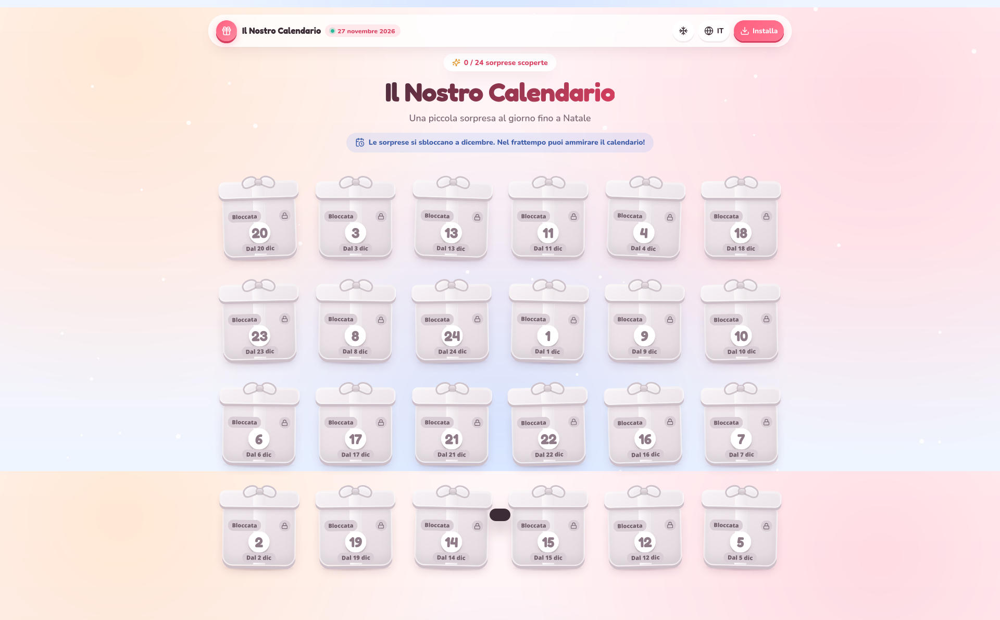

<div align="center">
<h1>🎄 Evergreen Advent Calendar 🎁</h1>

<p>
A cute, modern, 100% client-side 3D Advent Calendar Progressive Web App (PWA) built with pure HTML, CSS, and JavaScript—designed to be reused year after year. Featuring rounded 3D animated doors, anti-tamper server-time unlocking, multi-year state tracking, a universal multimedia viewer (including PDFs, Word, RTF, and WhatsApp Opus voice notes), Markdown companion comments, download protection, European multi-language support, and zero-backend folder indexing via Jekyll.
</p>

<div align="center">
  <a href="http://paypal.me/R0mb0">
    <picture>
      <source media="(prefers-color-scheme: dark)" srcset="https://github.com/R0mb0/Support_the_dev_badge/blob/main/Badge/SVG/Support_the_dev_badge_Dark.svg">
      <source media="(prefers-color-scheme: light)" srcset="https://github.com/R0mb0/Support_the_dev_badge/blob/main/Badge/SVG/Support_the_dev_badge_Light.svg">
      
    </picture>
  </a>
</div>

---

[](https://app.codacy.com/gh/R0mb0/Evergreen_advent_calendar/dashboard?utm_source=gh&utm_medium=referral&utm_content=&utm_campaign=Badge_grade)
[](https://github.com/R0mb0/Evergreen_advent_calendar/actions/workflows/jekyll_build.yml)
[](https://github.com/R0mb0/Evergreen_advent_calendar/actions/workflows/pages/pages-build-deployment)
[](https://github.com/R0mb0/Evergreen_advent_calendar)
[](https://github.com/R0mb0/Evergreen_advent_calendar)
[](https://opensource.org/license/mit)
[](http://paypal.me/R0mb0)

<h2><a href="https://r0mb0.github.io/Evergreen_advent_calendar/">👉 Click here to test the app! 👈</a></h2>

</div>

<!-- Replace with your own screenshots -->
[](https://r0mb0.github.io/Evergreen_advent_calendar/)

<hr>

<h2>🚀 Features</h2>
<ul>
<li><strong>Every Day Is a Gift 🎁</strong>: Each door is a cute 3D-styled gift box with a ribbon and bow. Hover it and the lid wiggles; open it and the lid flies away in a burst of sparkles and confetti. Future days are pale "sleeping" gifts, today's gift gently bounces and glows.</li>
<li><strong>"Find the Day" Mode (Store-Bought Calendar Style)</strong>: Enabled by default through <code>"randomOrder": true</code> in <code>config.json</code>. The gifts are shown in a scrambled, slightly tilted layout, so you have to <em>hunt for the number</em> just like in a commercial Advent calendar. The layout is fixed (same for every visitor and every visit) and can be changed with a seed—or switched off for the classic 1, 2, 3… grid.</li>
<li><strong>Modern &amp; Cute Responsive UI</strong>: Rounded clay-inspired design, celebratory confetti, a toggleable snowfall canvas, and a fluid grid (2 → 3 → 4 → 6 columns) tailored for both mobile phones and desktop monitors. Respects the <code>prefers-reduced-motion</code> accessibility setting.</li>
<li><strong>Evergreen Multi-Year Unlocking Logic</strong>: Date validation checks only the <em>month and day</em> (ignoring the year), allowing the calendar to live on forever. Each gift records the exact year it was last opened in <code>localStorage</code>—once opened, it stays open during the current season and automatically resets to closed whenever <code>currentYear &gt; lastOpenedYear</code>.</li>
<li><strong>Server-Verified Date &amp; Local Timezone Awareness</strong>: Reads the real current date from the hosting server's HTTP <code>Date</code> header (with a public time API as a second attempt) and maps it to the recipient's browser timezone—preventing casual clock-spoofing while falling back cleanly to the device clock when offline. A small colored dot next to the date tells where the date came from.</li>
<li><strong>Universal Client-Side Multimedia Viewer</strong>: Opens virtually any common personal media right inside the modal without external plugins:
  <ul>
    <li><strong>Images</strong>: PNG, JPG/JPEG, WebP, GIF, SVG, AVIF, BMP</li>
    <li><strong>Video</strong>: MP4, WebM, MOV, M4V, OGV (browser-supported codecs)</li>
    <li><strong>Audio</strong>: MP3, WAV, M4A, AAC, OGG, FLAC, and <strong>WhatsApp voice notes (<code>.opus</code>)</strong> with a built-in WebAssembly decoder fallback for Safari/iOS</li>
    <li><strong>Documents</strong>: <strong>PDF</strong> (rendered on canvas with page navigation and zoom), <strong>Word (<code>.docx</code>)</strong>, <strong>RTF (<code>.rtf</code>)</strong>, plain text (<code>.txt</code>, <code>.log</code>, <code>.csv</code>) and Markdown (<code>.md</code>)</li>
  </ul>
</li>
<li><strong>Multiple Files per Day</strong>: Put several files in the same day folder and they appear as tabs (a photo <em>and</em> a voice note <em>and</em> a PDF, for example).</li>
<li><strong>Markdown Companion Notes (<code>Readme.md</code>)</strong>: Drop a <code>Readme.md</code> inside any day's folder to attach a personal letter, poem, or note. Recipients can open it via the dedicated <strong>Comment</strong> button, with full Markdown rendering (headings, lists, tables, links, quotes). If a day contains <em>only</em> a <code>Readme.md</code>, it is shown directly.</li>
<li><strong>Zero-Maintenance Content Index</strong>: You never edit a file list by hand. A GitHub Actions workflow scans the day folders on every push, regenerates <code>days/manifest.json</code>, commits it back to the repository (so your local clone stays aligned) and publishes the site—you just add files and push.</li>
<li><strong>Configurable Download Protection (<code>config.json</code>)</strong>: Media downloads are <strong>disabled by default</strong> (<code>"allowDownload": false</code>)—hiding download controls, disabling casual right-click/drag actions, and rendering documents/media through built-in viewers. Flip a single boolean whenever you want to enable downloads. (See <a href="#security-privacy-notes">Security &amp; Privacy Notes</a> for the honest limits of this protection.)</li>
<li><strong>Graceful Missing-Content Fallbacks</strong>: Forgot to upload today's surprise before midnight? Built-in fallback handling displays a charming placeholder message instead of a broken viewer or console crash.</li>
<li><strong>Installable, Offline-Capable PWA</strong>: A service worker caches the app shell and the third-party libraries, so after the first visit the calendar opens even without a connection. A dedicated <strong>Install</strong> button in the toolbar (powered by <code>beforeinstallprompt</code>), install banners, a guided "Add to Home Screen" hint for iPhone/iPad, and an "Update ready" banner when a new version is published.</li>
<li><strong>European Multi-Language Support (Auto + Manual)</strong>: 🇮🇹 Italiano, 🇬🇧 English, 🇫🇷 Français, 🇩🇪 Deutsch, 🇪🇸 Español, 🇵🇹 Português, 🇳🇱 Nederlands and 🇵🇱 Polski. The language is detected from the browser, can be changed from the toolbar (and is remembered), and the calendar title/subtitle can be translated per language directly in <code>config.json</code>.</li>
<li><strong>Safe Rendering</strong>: Markdown, Word and RTF content is converted to HTML and sanitized with DOMPurify before being displayed.</li>
</ul>

<h2>💡 Motivation &amp; Why Use This?</h2>
<ul>
<li><strong>A Deeply Personal, Reusable Digital Gift</strong>: Built to share a daily surprise with a partner, family member, or close friend—combining photos, videos, letters, documents, and spontaneous WhatsApp voice notes inside one cohesive experience.</li>
<li><strong>Zero Subscriptions, Zero Third-Party Clouds</strong>: Most online Advent calendar tools charge fees, plaster watermarks over your memories, restrict file types, or delete your calendar after January. With this project, you own 100% of the code and media inside your own Git repository.</li>
<li><strong>Update Day-by-Day Without Stress</strong>: Because content is loaded dynamically from per-day folders, you don't even need all 24 days finished on November 30—you can commit and push new surprises throughout December, and the built-in fallback safely covers any day still in progress.</li>
<li><strong>Focus on the Content</strong>: No code to touch after the first setup. Edit a few lines in <code>config.json</code>, drop files in folders, push. The rest is automatic.</li>
</ul>

<h2>🛠️ How It Works</h2>
<ol>
<li><strong>Time Check</strong>: When the recipient opens the app, it retrieves the verified current date (adjusted to the browser's timezone) and compares it against the calendar month (e.g., December). On December 5, gifts <strong>1 through 5</strong> are unlockable while gifts <strong>6 through 24</strong> remain playfully locked.</li>
<li><strong>The Grid</strong>: The 24 gifts are laid out either in order or, with <code>randomOrder</code> enabled, in a fixed scrambled layout generated from a seed (a small seeded random generator + Fisher–Yates shuffle), so everybody sees the same calendar.</li>
<li><strong>Persistent State</strong>: Clicking an unlockable gift triggers the opening animation and saves the opening year in browser storage. Reloading the app keeps previously opened gifts visibly open for the rest of the year—and resets them automatically next December.</li>
<li><strong>Dynamic Folder Discovery</strong>: Static front-end sites cannot browse server directories directly for security reasons. On every push, the workflow runs <code>.github/scripts/generate_manifest.py</code>, which lists the files inside each <code>days/NN/</code> folder and writes them to <code>days/manifest.json</code>. The manifest is committed back to the repository, and the site is built with <strong>Jekyll</strong> and deployed to GitHub Pages.</li>
<li><strong>Rich Media &amp; Notes</strong>: Clicking an open gift launches the responsive viewer, rendering the day's multimedia file(s) along with the optional <code>Readme.md</code> note accessible through the <strong>Comment</strong> button.</li>
</ol>

<h2>⚡ Quick Start</h2>
<ol>
<li><strong>Get the code</strong>: Fork this repository (or use it as a template) and clone it.</li>
<li><strong>Enable GitHub Pages with Actions</strong>: In your repository go to <em>Settings → Pages → Build and deployment → Source</em> and select <strong>GitHub Actions</strong>. This step is required: the site is deployed by the included workflow.</li>
<li><strong>Personalize <code>config.json</code></strong>: Set the title and subtitle (see the <a href="#configuration-reference">configuration reference</a>). Make sure <code>"demoMode"</code> is <code>{ "enabled": false }</code>.</li>
<li><strong>Replace the sample content</strong>: The folders <code>days/01</code> … <code>days/24</code> contain <em>sample</em> files (one of every supported format) so you can try the app right away. Delete them and add your own surprises in the matching day folders.</li>
<li><strong>Push</strong>: <code>git add . &amp;&amp; git commit -m "My surprises" &amp;&amp; git push</code>. The workflow rebuilds the index and publishes the site at <code>https://&lt;your-user&gt;.github.io/&lt;repository&gt;/</code>.</li>
<li><strong>Share the link</strong>: Send it to the lucky person—on mobile they can also install it as an app.</li>
</ol>
<p><em>Tip:</em> the workflow commits <code>days/manifest.json</code> back to your repository, so run a <code>git pull</code> before your next push to stay in sync.</p>

<h2>📂 Content Structure &amp; Uploading Surprises</h2>
<p>Every gift corresponds directly to a numbered folder inside <code>days/</code>. Simply drop your media file(s) and an optional <code>Readme.md</code> into the matching day folder:</p>

```text
days/
├── manifest.json              # Generated automatically: do not edit by hand
├── 01/
│   ├── surprise_photo.jpg
│   └── Readme.md              # Optional personal comment rendered in Markdown
├── 02/
│   ├── voice_note.opus        # WhatsApp audio supported!
│   └── Readme.md
├── 03/
│   └── love_letter.pdf
├── 04/
│   ├── 1_photo.jpg            # Several files = several tabs
│   ├── 2_voice.opus           # (tabs follow alphabetical order)
│   └── 3_card.pdf
└── ...
```

<p><strong>Rules of thumb:</strong></p>
<ul>
<li><strong>Folder names</strong> are two digits: <code>01</code>, <code>02</code>, … <code>24</code>. Days without a folder (or with an empty one) show the friendly "no surprise yet" screen.</li>
<li><strong><code>Readme.md</code></strong> (any capitalization) is the optional note of the day. Alone, it is displayed directly; together with media files, it is reachable from the <strong>Comment</strong> button.</li>
<li><strong>Several files</strong> in one folder become tabs, sorted alphabetically (case-insensitive). The tab title is the file name without extension, so prefix names with <code>1_</code>, <code>2_</code>… to control the order.</li>
<li><strong>Spaces and accents</strong> in file names are fine (<code>Lettera di Natale.docx</code> works).</li>
<li><strong>Ignored files</strong>: hidden files (<code>.something</code>), <code>Thumbs.db</code>, <code>.DS_Store</code>, and any file starting with <code>_</code> (Jekyll does not publish those—the workflow prints a warning).</li>
<li><strong>Keep files reasonably small</strong>: GitHub Pages sites should stay under 1 GB, and single files under 100 MB. Compress videos (e.g., 720p H.264) before uploading.</li>
</ul>

<h2 id="configuration-reference">⚙️ Configuration Reference</h2>
<p>All settings live in <code>config.json</code>. Every key is optional: missing keys fall back to sensible defaults.</p>

| Key | Default | Description |
|---|---|---|
| `appTitle` | _"Calendario dell'Avvento"_ | Calendar title. Either a plain string or an object with one entry per language (`it`, `en`, `fr`, `de`, `es`, `pt`, `nl`, `pl`). |
| `appSubtitle` | _"Una piccola sorpresa al giorno fino a Natale"_ | Subtitle under the title (string or per-language object). |
| `totalDays` | `24` | Number of gifts in the calendar. |
| `targetMonth` | `12` | Month in which the gifts unlock (1–12). Outside this month the calendar is visible but locked. |
| `randomOrder` | `true` | `true`: scrambled, "find the day" layout. `false`: ordered 1, 2, 3… grid. |
| `randomOrderSeed` | `"evergreen"` | Text used to generate the scrambled layout. Change it to get a different (still fixed) layout. |
| `allowDownload` | `false` | Shows a download button and enables right-click/drag on media. |
| `enableSnow` | `true` | Initial state of the snowfall background (users can toggle it). |
| `enableConfetti` | `true` | Confetti when a gift is opened. |
| `offlineContent` | `"unlocked"` | Which gift files are saved for offline use: `"unlocked"` (days already open), `"all"` (every day) or `"none"` (only files the visitor opened). |
| `defaultLanguage` | `"auto"` | `"auto"` follows the browser, or force one of `it`, `en`, `fr`, `de`, `es`, `pt`, `nl`, `pl`. A language chosen by the user is remembered. |
| `timeApiFallbackUrl` | _timeapi.io (UTC)_ | Public time API used if the server date header is unavailable. Set it to `""` to disable. |
| `demoMode` | `{ "enabled": false, … }` | Simulated date for testing (see below). **Keep it disabled when you publish.** |

<h2>🧪 Testing Dates &amp; Local Development</h2>
<p>You do not have to wait for December to try the calendar:</p>
<ul>
<li><strong>Demo mode</strong>: set <code>"demoMode": { "enabled": true, "simulatedYear": 2026, "simulatedMonth": 12, "simulatedDay": 12 }</code>. A preview bar appears with selectors for year, month and day, plus a <strong>Reset</strong> button that clears the saved progress—handy to test the multi-year behavior. While demo mode is on, the server date check is bypassed, so remember to turn it off before sharing the link.</li>
<li><strong>Run it locally</strong>: from the repository root run <code>python3 .github/scripts/generate_manifest.py</code> (rebuilds the content index) and then <code>python3 -m http.server 8000</code>, and open <code>http://localhost:8000</code>. The app needs to be served over HTTP: opening <code>index.html</code> directly from the file system will not load the daily content.</li>
<li><strong>Service worker while developing</strong>: if you do not see your latest changes, do a hard refresh or unregister the service worker in your browser's developer tools (the cache name is controlled by <code>CACHE_VERSION</code> in <code>service-worker.js</code>).</li>
</ul>

<h2>📲 PWA &amp; Offline Use</h2>
<ul>
<li><strong>Install</strong>: Chrome, Edge, Brave and Opera on Android/desktop show the install prompt (toolbar button or banner). On iPhone/iPad (Safari), a banner explains <em>Share → Add to Home Screen</em>.</li>
<li><strong>100% self-hosted</strong>: every library and font lives in <code>libs/</code> and is served by your own site—no CDN is required at runtime. The <code>libs/</code> folder is filled automatically by the workflow on every deploy (see <a href="#offline-libraries">below</a>).</li>
<li><strong>Offline</strong>: on the first visit the service worker pre-caches the app shell, the libraries and the fonts. Right after that it also downloads, in the background, the files of every gift that is already unlocked (images, audio, video, documents, notes), so they open without a connection—audio/video seeking included. Change this with <code>offlineContent</code> in <code>config.json</code>: <code>"unlocked"</code> (default), <code>"all"</code> (also the days still locked) or <code>"none"</code> (only what the visitor has opened). <strong>Open the calendar online at least once</strong> before relying on it offline.</li>
<li><strong>Offline date</strong>: with no connection the app uses the device clock (the colored dot next to the date shows it).</li>
<li><strong>Updates</strong>: when you push a new version, installed apps show an "Update ready" banner; one tap reloads the new version. <code>config.json</code> and <code>days/manifest.json</code> are always fetched fresh when online, and each day's files carry a content hash (<code>?v=…</code>) so a replaced file is downloaded again automatically while unchanged ones are kept.</li>
</ul>

<h3 id="offline-libraries">📦 Getting the libraries (<code>libs/</code>)</h3>
<ul>
<li><strong>On GitHub</strong>: nothing to do—the workflow runs <code>python3 tools/download_libs.py</code> before building the site.</li>
<li><strong>Locally</strong> (to test offline or to commit the libraries in the repository): run <code>python3 tools/download_libs.py</code> from the repository root. Only Python 3 is needed; existing files are kept (<code>--force</code> downloads them again).</li>
<li><strong>Manually</strong> (e.g. with a download manager): save these files, keeping their names, into <code>libs/</code> — <code>unpkg.com/lucide@0.460.0/dist/umd/lucide.min.js</code>, <code>cdn.jsdelivr.net/npm/canvas-confetti@1.9.3/dist/confetti.browser.min.js</code>, <code>cdn.jsdelivr.net/npm/marked@12.0.2/marked.min.js</code>, <code>cdn.jsdelivr.net/npm/dompurify@3.1.7/dist/purify.min.js</code>, <code>cdn.jsdelivr.net/npm/mammoth@1.8.0/mammoth.browser.min.js</code>, <code>cdnjs.cloudflare.com/ajax/libs/pdf.js/3.11.174/pdf.min.js</code>, <code>cdnjs.cloudflare.com/ajax/libs/pdf.js/3.11.174/pdf.worker.min.js</code> and <code>cdn.jsdelivr.net/npm/ogg-opus-decoder@1.7.0/dist/ogg-opus-decoder.min.js</code>. The fonts are better fetched with the script (it skips files already present and only downloads <code>libs/fonts/</code>).</li>
<li><strong>Safety net</strong>: if a local file is missing, the app transparently loads the same version from the public CDN and the service worker caches it, so nothing breaks—it just is not offline-first for that file until it is downloaded.</li>
<li><strong>Changing a version</strong>: update it in <code>tools/download_libs.py</code>, <code>js/libs.js</code> and <code>service-worker.js</code> (the three lists must match), then bump <code>CACHE_VERSION</code>.</li>
</ul>

<h2 id="security-privacy-notes">🔒 Security &amp; Privacy Notes</h2>
<p>This is a <strong>100% static site</strong>, which makes it simple and free—but it also means you should know its limits:</p>
<ul>
<li><strong>Unlocking is enforced in the browser.</strong> The date check discourages clock tricks, but a determined person who knows (or guesses) a file URL such as <code>/days/24/photo.jpg</code> can open it directly, because every file of the repository is public once published. For a playful gift between people who trust each other this is perfectly fine; do <strong>not</strong> put truly confidential material in a public repository.</li>
<li><strong>Download protection is a deterrent, not DRM.</strong> It hides buttons and blocks casual right-click/drag, but anything shown on a screen can be saved by someone who really wants to.</li>
<li><strong>Offline date fallback.</strong> If the server date cannot be fetched (e.g., the device is offline), the app uses the device clock.</li>
<li><strong>Privacy.</strong> There is no backend, no account, no analytics and no cookies. Progress and language are stored only in the visitor's own browser (<code>localStorage</code>). Libraries and fonts are served by your own site (public CDNs are used only as a fallback if a local file is missing) and, only as a fallback, the date may be requested from timeapi.io (set <code>timeApiFallbackUrl</code> to <code>""</code> to disable it).</li>
</ul>

<h2>🧰 Third-Party Libraries</h2>

| Library | Version | Used for |
|---|---|---|
| [Lucide](https://lucide.dev/) | 0.460.0 | Rounded vector icons |
| [canvas-confetti](https://github.com/catdad/canvas-confetti) | 1.9.3 | Confetti on opening |
| [marked](https://github.com/markedjs/marked) | 12.0.2 | Markdown rendering |
| [DOMPurify](https://github.com/cure53/DOMPurify) | 3.1.7 | HTML sanitizing |
| [Mammoth.js](https://github.com/mwilliamson/mammoth.js) | 1.8.0 | Word (`.docx`) rendering |
| [PDF.js](https://mozilla.github.io/pdf.js/) | 3.11.174 | PDF rendering on canvas |
| [ogg-opus-decoder](https://github.com/eshaz/wasm-audio-decoders) | 1.7.0 | `.opus` fallback for Safari/iOS |
| [Fredoka &amp; Nunito](https://fonts.google.com/) | — | Fonts (self-hosted copy of the Google Fonts files, SIL OFL 1.1) |

<h2>🎨 Customization</h2>
<ul>
<li><strong>Colors &amp; look</strong>: the palette is defined by CSS variables at the top of <code>css/style.css</code> (<code>--berry</code>, <code>--mint</code>, <code>--gold</code>, <code>--sky</code>…); gift colors are defined per theme in the "Gift palettes" section of the same file.</li>
<li><strong>App name &amp; icons</strong>: edit <code>manifest.webmanifest</code> (<code>name</code>, <code>short_name</code>, colors) and replace the icons in <code>icons/</code> (<code>icon.svg</code>, <code>icon-192.png</code>, <code>icon-512.png</code>, <code>icon-512-maskable.png</code>, <code>apple-touch-icon.png</code>).</li>
<li><strong>Texts</strong>: every user-facing string is in <code>js/i18n.js</code> (interface) and <code>js/media-viewer.js</code> (viewer messages). Adding a language means adding an entry in both files.</li>
<li><strong>Another occasion</strong>: nothing is Christmas-specific in the logic. Change <code>targetMonth</code>, <code>totalDays</code> and the texts to build a calendar for another month or event.</li>
</ul>

<h2>🩺 Troubleshooting &amp; FAQ</h2>
<ul>
<li><strong>The site shows a 404 or the old page</strong> → Check <em>Settings → Pages → Source</em> is set to <strong>GitHub Actions</strong> and look at the <em>Actions</em> tab for a failed run.</li>
<li><strong>A day says "No surprise yet" although I added files</strong> → Make sure the folder name has two digits (<code>05</code>, not <code>5</code>), the file does not start with <code>_</code> or <code>.</code>, and that the workflow finished (it regenerates <code>manifest.json</code>). Locally, run <code>python3 .github/scripts/generate_manifest.py</code>.</li>
<li><strong>The workflow cannot push the manifest</strong> → If the <code>main</code> branch is protected, the push is skipped with a warning; the published site is still correct. Allow <code>github-actions[bot]</code> to push, or run the script locally and commit the manifest yourself.</li>
<li><strong>WhatsApp voice note does not play</strong> → Browsers without native Opus support (older Safari) use the WebAssembly decoder, which needs the library to be loaded once while online. Re-encoding the file to <code>.m4a</code> or <code>.mp3</code> also works everywhere.</li>
<li><strong>Everything is locked</strong> → The gifts unlock only during <code>targetMonth</code>. Try demo mode to preview other dates.</li>
<li><strong>I still see old content after an update</strong> → Close and reopen the app (the update banner appears when a new version is ready) or hard refresh the page.</li>
<li><strong>Can the visitors see each other's progress?</strong> → No. Progress is stored only in each visitor's own browser.</li>
</ul>

<h2>🧱 Project Structure</h2>

```text
Evergreen_advent_calendar/
├── .github/
│   ├── scripts/generate_manifest.py   # Builds days/manifest.json (files + content hash per day)
│   └── workflows/jekyll_build.yml     # Manifest → libraries → Jekyll build → GitHub Pages deploy
├── tools/
│   └── download_libs.py               # Downloads libraries & fonts into libs/ (offline use)
├── index.html
├── config.json                        # Calendar settings (title, random order, offline, …)
├── manifest.webmanifest               # PWA metadata & icons
├── service-worker.js                  # Offline cache & updates
├── _config.yml                        # Jekyll configuration
├── css/style.css
├── js/
│   ├── app.js                         # Grid, gifts, modal, snow, events
│   ├── libs.js                        # Local-first library loader (CDN fallback)
│   ├── i18n.js                        # Translations & language handling
│   ├── time-storage.js                # Verified date & multi-year storage
│   ├── media-viewer.js                # Images, video, audio, PDF, DOCX, RTF, text, Markdown
│   └── pwa-install.js                 # Install banners & service worker registration
├── libs/                              # Third-party libraries & fonts (filled by download_libs.py)
├── icons/
├── days/                              # Your daily surprises (01 … 24)
├── CITATION.cff
├── CODE_OF_CONDUCT.md
├── CONTRIBUTING.md
├── LICENSE
├── SECURITY.md
└── SUPPORT.md
```

<h2>🤝 Contributing, Support &amp; License</h2>
<ul>
<li>Found a bug or have an idea? Open an issue—see <a href="CONTRIBUTING.md">CONTRIBUTING.md</a> and the <a href="CODE_OF_CONDUCT.md">Code of Conduct</a>.</li>
<li>Questions or help: <a href="SUPPORT.md">SUPPORT.md</a>. Security reports: <a href="SECURITY.md">SECURITY.md</a>.</li>
<li>Released under the <a href="LICENSE">MIT License</a>. If you use it in research or a derivative project, you can cite it using <a href="CITATION.cff">CITATION.cff</a>.</li>
</ul>

<a href="https://github.com/R0mb0/Crafted_with_AI">
<picture>
<source media="(prefers-color-scheme: dark)" srcset="https://github.com/R0mb0/Crafted_with_AI/blob/main/Badge/SVG/CraftedWithAIDark.svg">
<source media="(prefers-color-scheme: light)" srcset="https://github.com/R0mb0/Crafted_with_AI/blob/main/Badge/SVG/NotMadeByAILight.svg">

</picture>
</a>
